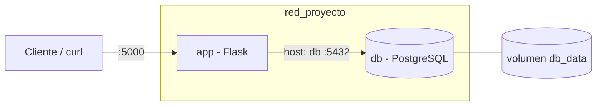

# Proyecto 1 – Docker con dos contenedores comunicados

Dos servicios orquestados con Docker Compose:

- **app**: API en Flask (Python 3.12) – contenedor 1.
- **db**: PostgreSQL 16.4 con volumen persistente – contenedor 2.

La app se conecta a la base de datos usando el **nombre del servicio** (`db`) dentro de la red `red_proyecto`.

## Arquitectura



## Estructura

```
.
├── app/
│   ├── Dockerfile
│   ├── app.py
│   ├── requirements.txt
│   └── .dockerignore
├── .github/workflows/docker.yml
├── docker-compose.yml
├── .env.example
└── README.md
```

## Cómo levantarlo

```bash
cp .env.example .env        # y edita las contraseñas
docker compose up --build
```

## Probar la comunicación (ida y vuelta)

```bash
# Guardar un dato (app -> db)
curl -X POST http://localhost:5000/notas -H "Content-Type: application/json" -d '{"texto":"hola"}'

# Leer el dato (db -> app)
curl http://localhost:5000/notas
```

## Comandos útiles para las evidencias

```bash
docker compose build
docker compose up -d
docker ps
docker network inspect <carpeta>_red_proyecto
docker compose down        # añade -v para borrar el volumen
```

## Seguridad

- Las credenciales viven en `.env` (ignorado por git); se incluye `.env.example`.
- Imágenes con versión fija, `.dockerignore`, usuario no root en la app y la BD sin puerto publicado al host.
